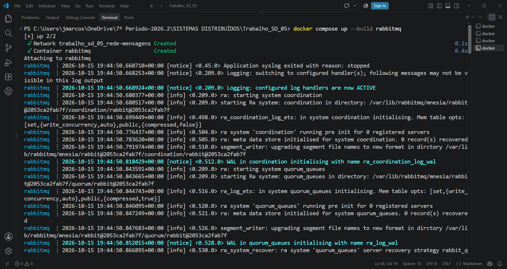
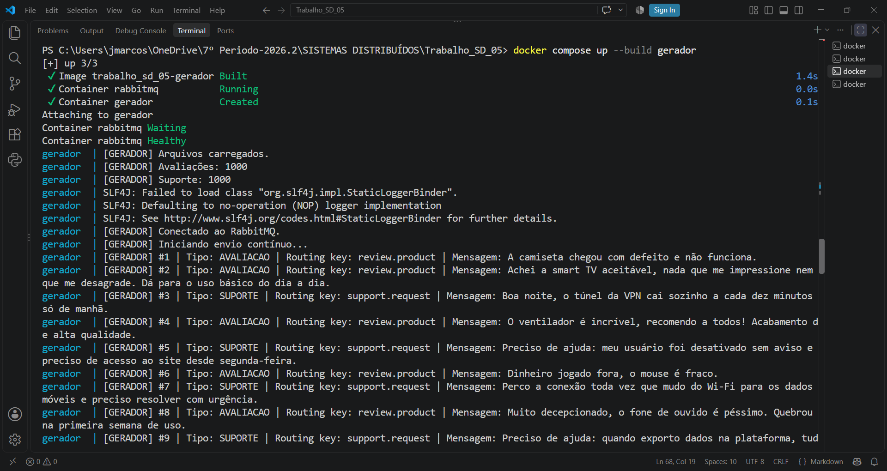
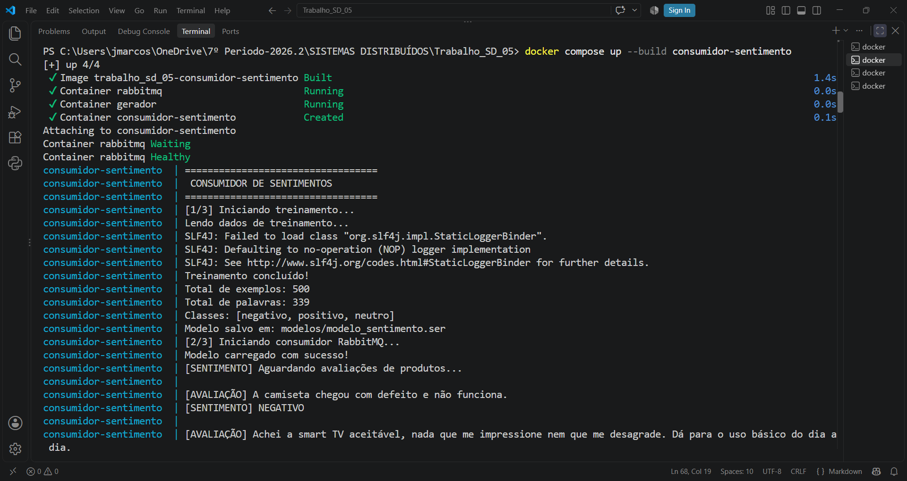
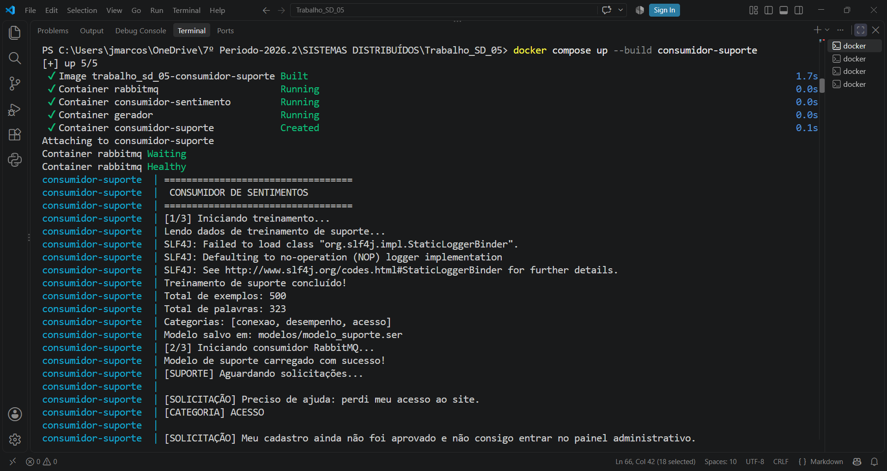
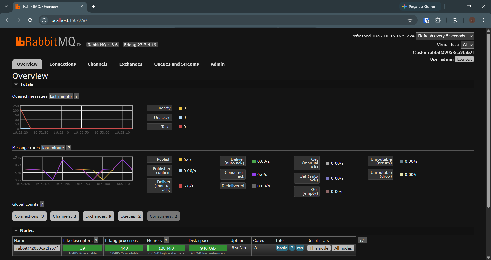
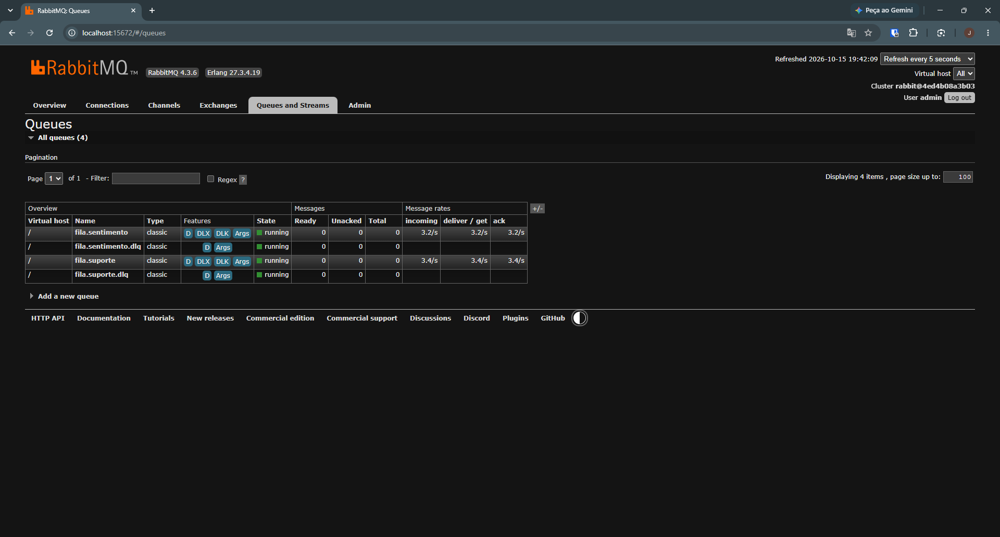

# Trabalho 05 - Sistema Distribuido
###  Sistema Distribuído de Classificação Inteligente de Mensagens com RabbitMQ

## Objetivo

Desenvolver um sistema distribuído utilizando Java, Docker e RabbitMQ para gerar,  e classificar mensagens automaticamente, usando Inteligência Artificial. O sistema possui um gerador de mensagens responsável por produzir e enviar automaticamente dois tipos de mensagens: avaliações de produtos e solicitações de suporte. Essas mensagens são publicadas no RabbitMQ, que utiliza um *Topic Exchange* para direcioná-las aos consumidores correspondentes. O primeiro consumidor recebe as avaliações de produtos e realiza a análise de sentimentos, classificando-as como positivas, negativas ou neutras. Já o segundo consumidor recebe as solicitações de suporte e classifica os problemas relatados em categorias como acesso, desempenho ou conexão. Dessa forma, cada consumidor processa seu próprio tipo de mensagem de forma independente, utilizando mecanismos de Inteligência Artificial para realizar as classificações.


## Classificação Inteligente das Mensagens

As duas inteligências artificiais utilizam a biblioteca Smile para Java e o algoritmo Naive Bayes Multinomial. Cada modelo foi treinado com um arquivo CSV contendo 500 linhas de exemplos, distribuídos entre três classes. A primeira IA classifica avaliações de produtos como positivas, negativas ou neutras, enquanto a segunda identifica solicitações de suporte relacionadas a problemas de acesso, desempenho ou conexão. Após o treinamento, os modelos são salvos e carregados pelos respectivos consumidores, permitindo classificar automaticamente as mensagens recebidas pelo RabbitMQ.

## Como Executar
### Pré-requisitos

- Docker instalado na máquina

Para executar o projeto no Docker, acesse a pasta raiz do projeto e execute o comando abaixo:
```bash
docker compose up --build -d
```


## Como Executar o Projeto

### Pré-requisitos

- [Docker](https://www.docker.com/) instalado na máquina.
- Docker Compose disponível.

### Iniciar todos os serviços

Na pasta raiz do projeto, execute o comando abaixo para construir as imagens e iniciar os quatro containers: RabbitMQ, gerador de mensagens e consumidores.

```bash
docker compose up --build -d
```

### 3. Acessar o RabbitMQ

Após iniciar os containers, acesse a interface de gerenciamento pelo navegador:

- **Interface Web:** [http://localhost:15672](http://localhost:15672)
- **Porta de comunicação:** `5672`

Utilize o usuário e a senha definidos nas variáveis `RABBITMQ_USER` e `RABBITMQ_PASSWORD` do arquivo `.env`.

Na interface, é possível acompanhar as filas, verificar o volume de mensagens e observar o funcionamento do sistema de mensageria.

### Visualizar os logs

Para acompanhar as mensagens geradas e os resultados das classificações:

```bash
# Logs de todos os serviços
docker compose logs -f

# Logs do gerador
docker compose logs -f gerador

# Logs do consumidor de sentimentos
docker compose logs -f consumidor-sentimento

# Logs do consumidor de suporte
docker compose logs -f consumidor-suporte

# Logs do RabbitMQ
docker compose logs -f rabbitmq
```

### 5. Encerrar a execução

Para parar e remover os containers e a rede criada pelo Docker Compose, execute:

```bash
docker compose down
```


## Evidências de Execução

### 1. RabbitMQ


### 2. Gerador


### 3. Consumidor de Sentimento


### 4. Consumidor de Suporte


### 5. Painel do RabbitMQ




